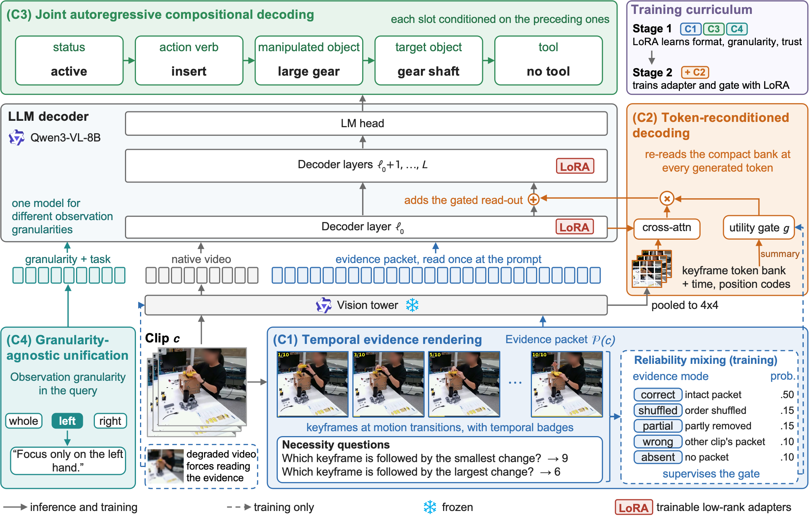

# RIVET: Rendered In-Video Evidence and Token-reconditioned Decoding

Reference implementation of RIVET, a vision-language model for fine-grained
assembly action understanding. One VLM answers an assembly observation at a
requested granularity — the whole action, the left hand, or the right hand — and
emits a composition of five slots rather than a single closed-set label.



A prediction is correct only when all five slots match exactly:

```
status, verb, manipulated_object, target_object, tool
```

The same code serves HA-ViD (an acting hand is annotated) and Assembly101 and
IKEA ASM (it is not). The backbone is
[Qwen3-VL-8B-Instruct](https://huggingface.co/Qwen/Qwen3-VL-8B-Instruct) with
LoRA.

## Method

RIVET comprises four components.

- **(C1) Temporal evidence rendering.** The clip is rendered into a compact
  evidence packet whose keyframes carry temporal badges and whose
  self-verification questions are answerable only from the packet itself.
  Reliability mixing presents the packet at a controlled reliability and trains
  a binary arbitration target, so corrupted evidence degrades gracefully.
- **(C2) Token-reconditioned decoding.** The packet enters the model through the
  prompt, where it is read once, and through a decoder-side adapter
  (`SpatialEvidenceAdapter`) that re-reads the keyframes at each generated token,
  conditioning the read-out on the token. The adapter is injected at decoder
  layer 0 and its injection scale is gated by a learned utility gate.
- **(C3) Joint autoregressive compositional decoding.** The description is
  generated as a single autoregressive sequence of five slots — status, action
  verb, manipulated object, target object, and tool — each conditioned on the
  preceding ones.
- **(C4) Granularity-agnostic unification.** The observation granularity is
  expressed in the query to the VLM rather than as an index over separately
  trained models.

Stage 1 trains the LoRA on the video and the evidence packet. Stage 2 adds the
decoder-side adapter on a Stage-1 checkpoint.

## Layout

```
data/        clips, workspace crops, manifests, evidence packets
model/       adapter, training, inference, metrics
configs/     one config per corpus; method.yaml is the shared experiment matrix
scripts/     end-to-end drivers
assets/      figures
tests/       offline tests (no GPU, no VLM)
```

Generated clips, evidence and checkpoints go under `artifacts/` and `outputs/`.
They are not part of this repository.

`model/hand_anchored.py` is an ablation that was measured and not selected.
The reported method does not call it.

## Reported configuration

`configs/method.yaml` fixes the recipe used on every corpus:

- temporal badges, necessity questions, reliability mixing, a degraded-video arm
  and an arbitration gate are on
- Stage 2 injects evidence features at decoder layer 0
- seed 17; the primary metric is 5-slot exact match under `hard_id` decoding

| Corpus | View | Train split | Stage 1 | Stage 2 |
|---|---|---|---|---|
| HA-ViD | side, frontal, overhead | `train_aug`, both hands pooled | `rivet_r_sft_no_som` | `model.run_spatial`, variant `d_L0_v2` |
| IKEA ASM | top, workspace-cropped | `train_aug` | `ikea_parent` | `model.run_informative`, variant `ikea_L0_v2` |
| Assembly101 | fixed view, workspace-cropped, head cap 200 | `train_aug200` | `a101c_parent` | `model.run_informative`, variant `a101c_L0_v2` |

IKEA ASM annotates no tools and Assembly101 annotates no idle state, so one
slot is constant on each. `model.run_informative` drops that slot from the
auxiliary loss only. The output schema, the prompt and the exact-match metric
stay the same as on HA-ViD, where the two launchers compute the same loss.

## Results

Exact-match accuracy (%), RGB input alone.

| Corpus | Metric | RIVET (Stage 1+2) | Comparison |
|---|---|---|---|
| HA-ViD | left / right Top-1, 3-view avg | 71.6 / 70.1 | +9.0 / +7.3 over CoDuAR, the previously strongest dual-hand method |
| IKEA ASM | mAcc / Top-1 | 59.2 / 82.4 | best mAcc, ahead of every method including ground-truth skeleton+mask oracles |
| Assembly101 | action Top-1 | 41.1 | ahead of every RGB-only and pose-only model; tied with the best RGB+pose model |

Assembly101 element accuracies: verb 66.7, manipulated object 54.4,
target object 88.9, tool 97.2. The full method trains 67.1M parameters
(LoRA + adapter) against CoDuAR's 134M.

## Pipeline

```bash
# 1. Clips, crops, manifests.
python -m data.havid --view v1 --workers 24
python -m data.ikea
python -m data.assembly101
python -m data.crop \
    --manifests artifacts/<corpus>/manifests/train.jsonl \
    --crop x1,y1,x2,y2 --src_root artifacts/<corpus>/clips \
    --out_root artifacts/<corpus>/clips_cropped

# 2. Evidence packets (CPU; shard for parallelism).
python -m data.shard --root artifacts/<corpus>/manifests --splits train test --shards 8
python -m data.evidence --config configs/evidence_<corpus>.yaml \
    build --resume --splits train_sh00

# 3. Vision features of the evidence keyframes. feature_dim 1152 is Qwen3-VL.
python -m model.features_vlm --config configs/<corpus>.yaml \
    --splits train,test --device cuda --output_dirname features_vlm

# 4. HA-ViD only: pool the two hands, then long-tail augmentation.
python -m model.pool --out_root artifacts/havid
python -m model.augment \
    --manifest artifacts/havid/manifests/train.jsonl \
    --out_manifest artifacts/havid/manifests/train_aug_only.jsonl \
    --merged_manifest artifacts/havid/manifests/train_aug.jsonl \
    --video_root artifacts/augmented_clips --target 60 --max_per_clip 4

# 5. Stage 1.
python -m model.train \
    --config configs/<corpus>.yaml --variant <parent> \
    --matrix configs/method.yaml \
    --train_split train_aug --seed 17 --resume --stop_after_epoch 4

# 6. Stage 2. HA-ViD uses run_spatial; IKEA ASM and Assembly101 use run_informative.
python -m model.run_spatial train \
    --config configs/<corpus>.yaml --variant <child> \
    --matrix configs/method.yaml \
    --train_split train_aug --seed 17 --resume --stop_after_epoch 4

# 7. Grammar-constrained inference.
python -m model.infer \
    --config configs/<corpus>.yaml --variant <child> \
    --matrix configs/method.yaml \
    --train_split train_aug --seed 17 --split test --output_suffix epoch_4
```

`scripts/havid.sh`, `scripts/assembly101.sh` and `scripts/assembly101_cropped.sh`
run these steps for one corpus. `scripts/stage2.py` prints the launcher a
variant declares in the matrix.

## Weights

Released checkpoints are LoRA adapters on `Qwen/Qwen3-VL-8B-Instruct`. Download
the base model separately. The adapter directory is what `--model_dir` points
at during inference.

## Requirements

See `requirements.txt`. Evidence construction runs on CPU.
Feature extraction and training need a CUDA GPU and the Qwen3-VL weights.

```bash
pytest tests
```
